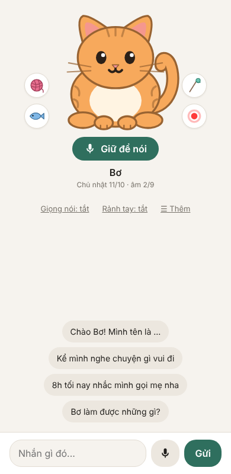
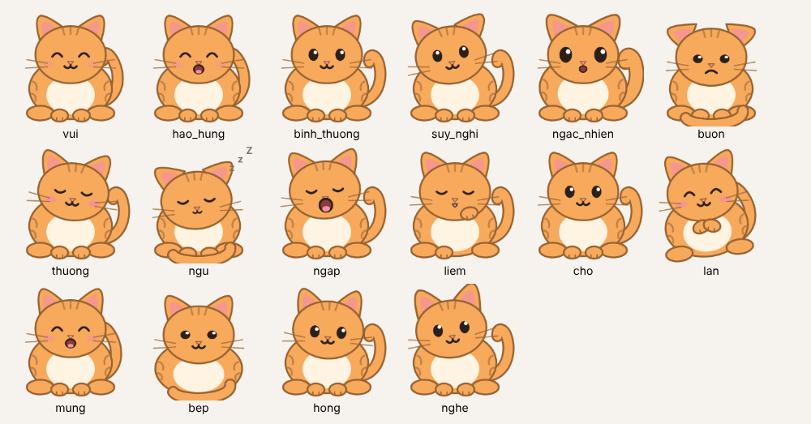
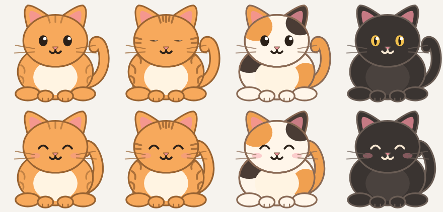
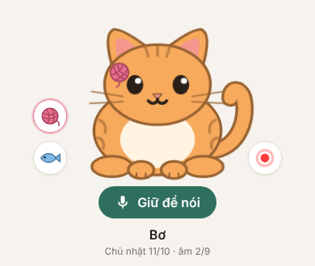
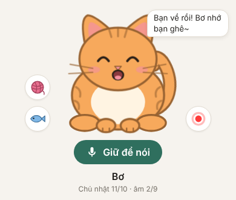

# Bơ – mèo béo AI



Bơ là một con mèo béo biết trò chuyện, có tính cách, có trí nhớ, biết vui/buồn/ngạc nhiên, ngáp, liếm chân, ngủ gật.
Mèo vẽ bằng SVG (`web/meo.js`, `web/meo.css`), đọc JSON cảm xúc từ "bộ não"; sau này có thể gắn vào phần cứng.



## Chạm & chơi với Bơ (miễn phí, không tốn API)

| | |
|---|---|
| **Vuốt** đầu/lưng → nhắm mắt, kêu rừ rừ, tim bay; vuốt lâu → Bơ nhồi bột | **Gãi cằm** → ngửa cổ sướng · **Chạm tai** → tai giật |
| **Chọc bụng** → giật mình; chọc 5 lần liền → dỗi quay lưng | **Nhấn giữ bụng/lưng ~1 giây** → lăn qua lăn lại nũng nịu |
| **Nút cá** → Bơ ăn, liếm mép (nhấn giữ: chọn cá / sữa / pate) | **Nút cuộn len** → kéo ném, len lăn, nảy, Bơ vồ |
| **Nút chấm đỏ** → tia laser theo ngón tay, Bơ nhìn theo và vồ | **Nút lông vũ** → cần câu lông vũ, đưa lên đầu Bơ là Bơ giơ chân vồ |
| Mắt Bơ **nhìn theo** chuột/ngón tay | Đang gõ tin thì Bơ **hóng chuyện**; rảnh 1 phút Bơ nằm bẹp "ổ bánh mì" |
| **Vuốt ngược lông** (kéo lên trên ở hai bên lưng) → Bơ xù lông, nheo mắt | **Chạm hai lần vào chân trước** → Bơ giơ chân đập tay "Bốp!" |
| Lúc rảnh Bơ tự ngáp, liếm chân, **rửa mặt**, **ngó quanh** | Gọi **"Bơ ơi"** (rảnh tay) → Bơ nghiêng đầu "Dạ?" |
| **Giữ yên tay trước mũi** → Bơ ngửi rồi cọ má | **Chạm đuôi** → đuôi vụt đi · **Lắc điện thoại** → Bơ chóng mặt @_@ |
| **Nhấn giữ đầu rồi kéo lên** → bế Bơ, chân lủng lẳng | **Lông vũ quét mũi** → Bơ hắt xì · **thả lông sát đất** → Bơ rình, ngoáy mông rồi vồ · **lông bên hông** → Bơ quơ chân · **len nằm yên sát Bơ** → Bơ ôm cắn rồi đá văng |
| **Chạm chóp mũi** → boop! Bơ chun mũi | **Chạm má** → Bơ nghiêng đầu dụi vào tay |

Lâu rồi mới mở web thì Bơ mừng rỡ "Bạn về rồi!"; sáng sớm Bơ vươn vai; khuya Bơ lim dim. Không có thanh "đói", không bị phạt khi bỏ đi lâu.
Bàn phím: Tab tới Bơ, Enter = xoa đầu, phím cách = gãi cằm.
Đổi màu lông và **kiểu lông** (thường, mướp vằn, tam thể, mèo đen) trong "Bơ làm được gì? · Cài đặt".



  

Chụp lại ảnh sau khi sửa giao diện: `python scripts/chup_meo.py` (cần `pip install playwright`).

## Chạy trên Windows

1. Cài [Python 3.11+](https://www.python.org/downloads/) (nhớ tick "Add Python to PATH").
2. Tải code về: `git clone https://github.com/TanVu15/ai-companion.git`
3. Nhấp đúp `run.bat`. Lần đầu nó tự cài thư viện và tạo file `.env`.
4. Mở file `.env`, dán API key vào dòng `ANTHROPIC_API_KEY=`, rồi chạy lại `run.bat`.
5. Mở trình duyệt: http://localhost:8000

**Chưa có API key?** Đặt `DEMO=1` trong `.env` để xem giao diện trước. Bot sẽ chỉ nhắc lại lời bạn và đổi biểu cảm liên tục.

**Dùng trên iPhone:** điện thoại và máy tính phải chung wifi. Gõ `ipconfig` trên máy tính để xem địa chỉ IPv4 (ví dụ 192.168.1.5), rồi trên iPhone mở `http://192.168.1.5:8000`. Nếu không vào được, cho phép Python qua Windows Firewall.

**Đưa Bơ ra màn hình chính iPhone:** mở trang Bơ bằng Safari → nút Chia sẻ (ô vuông có mũi tên) → "Thêm vào MH chính". Bơ có biểu tượng riêng và mở toàn màn hình như một ứng dụng.

**Dùng khi ra ngoài (không chung wifi):** xem [DUA_LEN_MANG.md](DUA_LEN_MANG.md). Nhớ đặt `APP_PASSWORD` trong `.env` trước.

**Gặp lỗi?** Xem [SU_CO.md](SU_CO.md).

## Nói chuyện bằng giọng

- **Bơ đọc to câu trả lời:** bấm "Giọng nói: tắt" dưới mèo để bật. Bơ dùng **giọng AI miễn phí** (edge-tts, giọng tiếng Việt của Microsoft, cần mạng, không cần tài khoản); giọng vui/buồn nhẹ theo cảm xúc của câu. Không có mạng thì tự dùng giọng có sẵn của máy.
- **Chỉnh giọng:** "Bơ làm được gì? · Cài đặt" → chọn giọng, tốc độ, cao độ, hoặc giọng mẫu "Mèo con" / "Mèo béo lười". Mục **Tình trạng** báo giọng AI có dùng được không.
- **Giữ để nói:** giữ nút to dưới mèo, nói, thả tay là gửi; Bơ trả lời ngắn và đọc to.
- **Bắt Bơ im:** chạm vào Bơ khi Bơ đang đọc (hoặc bấm Esc).
- **Nói thay vì gõ:** bấm nút micro cạnh nút Gửi, nói xong ngừng một chút là tự gửi. Chạy tốt nhất trên Chrome, Edge, Safari.
- **Rảnh tay:** bấm "Rảnh tay: tắt" để bật. Bơ nghe liên tục nhưng chỉ trả lời khi được gọi: "Bơ ơi, hôm nay trời đẹp ghê" hoặc gọi "Bơ ơi" trước rồi nói trong 8 giây. Lúc Bơ đang nói thì tạm ngừng nghe.
- Nút micro chỉ hiện khi mở bằng `http://localhost:8000` hoặc link `https://...` (trình duyệt chặn micro trên địa chỉ `http://192.168...`). Trên iPhone muốn dùng micro thì dùng link https ở [DUA_LEN_MANG.md](DUA_LEN_MANG.md) (Cách 2), hoặc dùng nút micro trên bàn phím iPhone để đọc chính tả.

## Nhờ Bơ nhắc việc

Nhắn kiểu "8h tối nhắc mình gọi mẹ" hoặc "30 phút nữa nhắc mình tắt bếp". Tới giờ Bơ nhắn (và đọc to nếu bật giọng nói).
Nhắc lặp lại cũng được: "mỗi ngày 7h sáng nhắc mình uống nước", "tối thứ Hai hằng tuần 8h nhắc mình họp nhóm".
Bơ ghi được thì dưới câu trả lời có dòng nhỏ "✓ Bơ đã ghi: nhắc 20:00 12/10: Gọi mẹ" (việc cần làm, thói quen, điều nhớ, nhật ký cũng báo như vậy). Không thấy dòng đó nghĩa là Bơ chưa ghi, nhờ lại cho rõ giờ.
Dưới lời nhắc có nút "Nhắc lại sau 10 phút".
Chỉ nhắc được khi **máy tính đang chạy Bơ và trang web đang mở**. Xem/xóa lời nhắc trong "Bơ nhớ gì về mình?".

## Những thứ khác Bơ làm được

- **Nút "?"**: danh sách mẹo dùng + Bơ và bạn đã quen bao nhiêu ngày.
- **Hỏi thăm chuyện cũ:** kể "tối nay đi đá bóng" → hôm sau mở web Bơ tự hỏi. 2 ngày không chat thì Bơ chào "lâu quá không gặp".
- **Âm lịch & ngày lễ:** Bơ tự tính ngày âm (không cần mạng) và biết hôm nay/ngày mai là lễ gì (Tết, Trung thu, 20/10...); ngày lễ mở web là Bơ chúc (tắt bằng `CHUC_LE=0`). Danh sách ngày đặc biệt ghi "còn mấy ngày"; hỏi "còn mấy ngày nữa sinh nhật mẹ?" Bơ trả lời được.
- **Ngày đặc biệt:** kể "sinh nhật mẹ 5/3" hoặc "giỗ ông 15/7 âm lịch" → hôm trước Bơ nhắc "mai sinh nhật mẹ đó", đúng ngày Bơ chúc (mỗi năm một lần).
- **Việc cần làm:** "nhớ giúp mình mua sữa" (không có giờ) → Bơ ghi vào danh sách; "mua sữa rồi" → Bơ gạch. Nút "Việc cần làm" để xem, đánh dấu xong, thêm, xóa.
- **Tâm trạng:** Bơ đoán bạn vui/buồn/mệt qua tin nhắn; nút "?" có dải tâm trạng 7 ngày. Mấy hôm liền buồn/mệt thì Bơ nhẹ nhàng, quan tâm hơn.
- **Tổng kết tuần:** tối Chủ nhật (từ 17h) mở web, Bơ điểm lại tuần qua. Tắt bằng `WEEKLY_RECAP=0`.
- **Tìm chuyện cũ:** nút "Tìm", gõ không dấu cũng được.
- **Ghim tin nhắn:** chạm vào một tin → "Ghim tin này". Xem lại ở nút "Tìm" (khi chưa gõ gì).
- **Sao lưu:** trong "Bơ nhớ gì về mình?" → tải bản sao lưu (.json, nạp lại được) hoặc tải trò chuyện (.txt, để đọc). Ngoài ra Bơ **tự sao lưu mỗi ngày** vào `data/sao_luu/` (giữ 7 bản; tắt bằng `TU_SAO_LUU=0`) — lỡ "Xóa hết" thì nạp lại bản hôm qua.
- **Nhật ký:** kể Bơ nghe chuyện trong ngày, Bơ ghi một dòng vào nút "Nhật ký"; hỏi "hôm qua mình làm gì nhỉ?" Bơ kể lại.
- **Thói quen:** "theo dõi giúp mình thói quen đọc sách" → mỗi ngày kể "đọc sách rồi" là Bơ đánh dấu; nút "Thói quen" xem chuỗi ngày liền.
- **Lịch điện thoại:** "Bơ nhớ gì về mình?" → "Tải lịch cho điện thoại (.ics)" → mở file trên iPhone/Android để thêm ngày đặc biệt (cả ngày âm lịch, ghi sẵn 10 năm) và lời nhắc vào app Lịch.
- **Thời tiết:** đặt `THANH_PHO=Da Nang` (tên thành phố, không dấu cũng được) trong `.env` → Bơ biết trời nắng/mưa hôm nay và ngày mai, nhắc mang áo mưa khi hợp chuyện. Miễn phí (Open-Meteo), không cần tài khoản.
- **Cài đặt trên web:** nút "?" → mục Cài đặt: thành phố, giờ yên lặng, tổng kết tuần. Lưu ở `data/cai_dat.json`, ưu tiên hơn `.env`; "Về như file .env" để bỏ.
- **Chi phí:** nút "Chi phí". Đặt `MONTHLY_USD_LIMIT` trong `.env` để giới hạn tiền mỗi tháng.

## Nối phần cứng (ESP32)

Xem [THIET_BI.md](THIET_BI.md): đặt `DEVICE_KEY` trong `.env`, thiết bị gửi chữ tới `/api/thiet-bi/chat` và nhận JSON cảm xúc/hành động.

## Đổi tính cách

Bấm nút **"Tính cách"** trên web, sửa rồi bấm "Lưu" — áp dụng từ tin nhắn sau. Bản bạn sửa lưu riêng ở `data/persona_tu_sua.md` (git pull không đè; 10 bản trước giữ ở `data/persona_tu_sua.<ngày giờ>.md`). Bấm "Về mặc định" để dùng lại `persona.md` gốc của dự án.

## Thử tính cách (chấm điểm)

Bơ trả lời 22 tình huống trong `tinh_huong.json` (buồn, mệt, khoe thành tích, hỏi điều không biết, hỏi thăm chuyện cũ, sinh nhật, nhắc mỗi ngày, việc cần làm, đoán tâm trạng, âm lịch...) và được chấm điểm tự động. Tốn khoảng 22 câu API (rất rẻ), không đụng vào trí nhớ thật.

```
.venv\Scripts\activate
python -m app.thu_tinh_cach
```

Muốn thêm tình huống thì sửa `tinh_huong.json`.

## Cấu trúc

```
app/brain.py    Bộ não: ghép tính cách + trí nhớ + lịch sử, hỏi Claude, đọc JSON
app/memory.py   Trí nhớ: SQLite lưu tin nhắn và điều đáng nhớ (data/companion.db)
app/main.py     Máy chủ web (FastAPI)
web/index.html  Giao diện chat + khuôn mặt (HTML + CSS)
web/app.js      Khung chat: gửi tin, bong bóng, khuôn mặt, lịch sử
web/giong_noi.js  Giọng nói: đọc to, micro, rảnh tay, chọn giọng
web/khoi_dong.js  Chi phí, lời chào, lời nhắc, khởi động trang
web/hop_thoai.js  Hộp thoại: trí nhớ, tìm, "?", ghim, tính cách, màu mặt, phím tắt
web/danh_thuc.js, web/doc_to.js   Từ đánh thức "Bơ ơi", dọn chữ trước khi đọc to
persona.md      Tính cách
app/thu_tinh_cach.py + tinh_huong.json   Bộ câu hỏi thử tính cách
tests/          Test bằng bộ não giả, không tốn tiền API
```

Mỗi câu trả lời của bộ não có dạng:

```json
{ "noi": "...", "cam_xuc": "vui", "hanh_dong": "gat_dau", "ghi_nho": ["..."] }
```

`cam_xuc` và `hanh_dong` hiện điều khiển khuôn mặt trên web; sau này sẽ điều khiển phần cứng.

## Chạy test

```
pip install -r requirements.txt
python -m pytest -q
```
